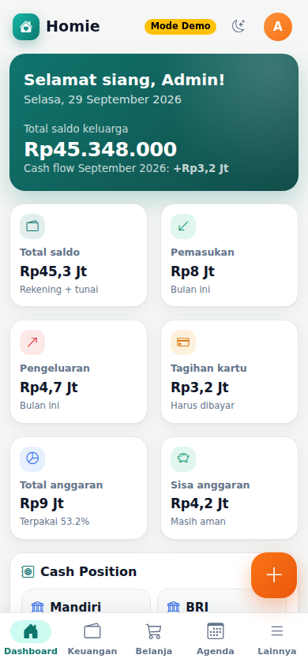
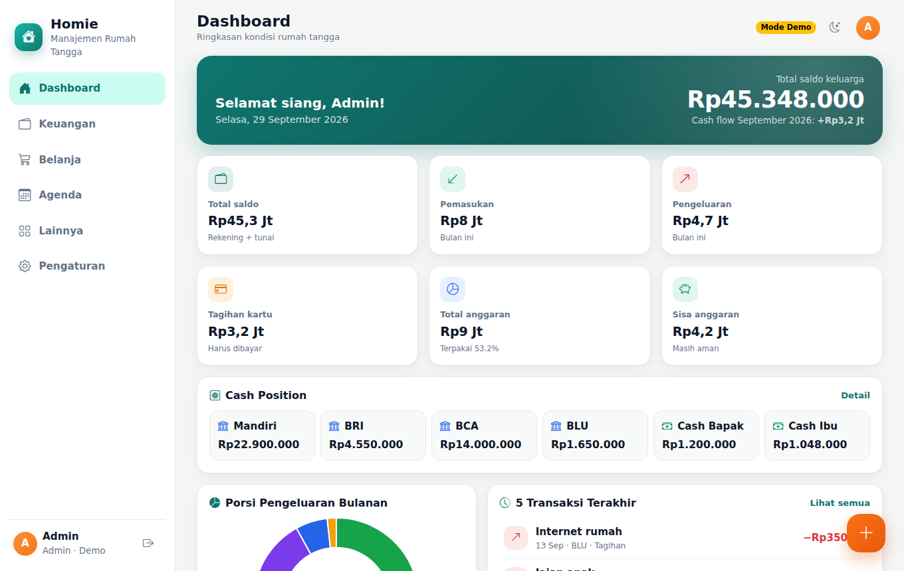
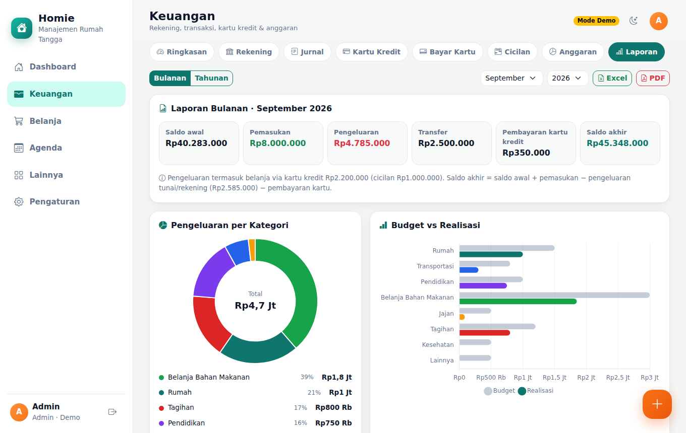

# 🏠 Homie — Manajemen Rumah Tangga

**Keuangan, Belanja & Agenda Keluarga** — aplikasi web gratis untuk membantu keluarga Indonesia mengelola
keuangan, rekening, kartu kredit, cicilan, anggaran, daftar belanja, agenda/tugas, dan dokumen keluarga dalam satu tempat.

- Berjalan di browser HP maupun laptop, dan bisa dipasang ke layar utama HP (PWA, nama **Rumah**).
- Dipublikasikan **gratis** lewat **GitHub Pages**.
- Database memakai **Google Sheets**, backend memakai **Google Apps Script** — tanpa server berbayar.
- Bahasa Indonesia, format Rupiah (`Rp15.400.000`), tanggal `dd/mm/yyyy`, zona waktu `Asia/Jakarta`.

> Panduan instalasi langkah demi langkah ada di **[INSTALASI.md](INSTALASI.md)**: GitHub Pages + Google, PC server di rumah, atau hosting gratis lain (Netlify, Cloudflare Pages, Vercel).
> Petunjuk khusus backend ada di **[google-apps-script/README.md](google-apps-script/README.md)**.

---

## Daftar isi

- [A. Arsitektur aplikasi](#a-arsitektur-aplikasi)
- [B. Struktur folder](#b-struktur-folder)
- [Fitur](#fitur)
- [Screenshot](#screenshot)
- [Teknologi](#teknologi)
- [C & D. Source code frontend dan Apps Script](#c--d-source-code)
- [E. Struktur database Google Sheets](#e-struktur-database-google-sheets)
- [F. Sample data](#f-sample-data)
- [G–I. Instalasi & deployment](#gi-instalasi--deployment)
- [Konfigurasi](#konfigurasi)
- [Cara kerja perhitungan](#cara-kerja-perhitungan)
- [Keamanan & keterbatasan](#keamanan--keterbatasan)
- [J. Testing checklist](#j-testing-checklist)
- [K. Troubleshooting](#k-troubleshooting)
- [L. Cara update aplikasi](#l-cara-update-aplikasi)
- [Backup database](#backup-database)

---

## A. Arsitektur aplikasi

```
┌──────────────────────────────┐
│  Frontend (GitHub Pages)     │  HTML5 + CSS3 + JavaScript ES6 (modul), Bootstrap 5,
│  index.html, css/, js/       │  Bootstrap Icons, Chart.js, SheetJS, jsPDF, PWA
└──────────────┬───────────────┘
               │ HTTPS POST (JSON, Content-Type text/plain)
┌──────────────▼───────────────┐
│  Backend / API               │  Google Apps Script Web App
│  google-apps-script/*.gs     │  doPost → router → validasi → hitung → respons JSON
└──────────────┬───────────────┘
               │ SpreadsheetApp
┌──────────────▼───────────────┐
│  Database: Google Sheets     │  11 sheet: Users, Accounts, Transactions, Categories, Budgets,
│  "Database Manajemen RT"     │  CreditCards, Installments, Shopping, Agenda, FamilyDocuments, Settings
└──────────────┬───────────────┘
               │ (link saja)
┌──────────────▼───────────────┐
│  Dokumen: Google Drive       │  File KTP/KK/paspor disimpan di Drive pribadi.
└──────────────────────────────┘  Aplikasi hanya menyimpan metadata + link.
```

Alur singkat:

1. Pengguna membuka website (GitHub Pages) → memilih nama & memasukkan PIN.
2. Frontend mengirim `{"action":"login","data":{...}}` ke Web App URL. Apps Script memeriksa hash PIN di sheet **Users**, lalu memberi token sesi (berlaku 6 jam).
3. Setiap permintaan berikutnya membawa token. Apps Script memeriksa role (Admin/Bapak/Ibu/Viewer), memvalidasi input, membaca/menulis Google Sheets, menghitung saldo & ringkasan, lalu mengembalikan JSON:

```json
{ "success": true, "message": "Data berhasil disimpan", "data": {} }
```

atau bila gagal:

```json
{ "success": false, "message": "Saldo Mandiri tidak mencukupi untuk transaksi ini." }
```

**Mode Demo.** Jika `js/config.js` belum dibuat, aplikasi otomatis berjalan dalam Mode Demo: file `.gs` yang sama
dijalankan langsung di browser dengan Google Sheets tiruan di memori. Cocok untuk mencoba tampilan sebelum setup.
Data demo hilang saat halaman dimuat ulang.

## B. Struktur folder

```
homie/
├── index.html                  Halaman utama (single page app)
├── manifest.json               Manifest PWA (nama "Homie — Manajemen Rumah Tangga", short name "Homie")
├── service-worker.js           Cache file frontend untuk PWA/offline shell
├── README.md                   Dokumen ini
├── INSTALASI.md                Pilih cara instalasi (ringkasan & perbandingan)
├── docs/
│   ├── INSTALASI-1-GITHUB-GOOGLE.md  GitHub Pages + database Google (Sheets, Apps Script, Drive)
│   ├── INSTALASI-2-PC-SERVER.md      PC server di rumah (XAMPP / Nginx, Tailscale)
│   └── INSTALASI-3-HOSTING-GRATIS.md Netlify, Cloudflare Pages, Vercel
├── LICENSE                     Lisensi MIT
├── .gitignore
├── css/
│   ├── style.css               Tema, komponen, dark mode
│   └── responsive.css          Tata letak HP / tablet / desktop
├── js/
│   ├── app.js                  Titik masuk: login, layout, router, tema, PWA
│   ├── api.js                  Komunikasi ke Apps Script + Mode Demo + data master
│   ├── config.example.js       Contoh konfigurasi → salin menjadi config.js
│   ├── dashboard.js            Dashboard
│   ├── finance.js              Keuangan: ringkasan, rekening, form transaksi, jurnal, anggaran, kategori
│   ├── creditcard.js           Kartu kredit, bayar kartu, cicilan
│   ├── shopping.js             Belanja Mandatory & Complementary
│   ├── agenda.js               Tugas, kalender, agenda harian
│   ├── documents.js            Dokumen keluarga & pengingat masa berlaku
│   ├── reports.js              Laporan bulanan/tahunan, export Excel & PDF
│   ├── settings.js             Pengaturan, pengguna, backup
│   ├── ui.js                   Toast, modal, skeleton, grafik
│   ├── utils.js                Format rupiah/tanggal & fungsi perhitungan
│   └── demo-backend.js         Runtime Mode Demo (Google Sheets tiruan)
├── assets/
│   ├── icons/                  Ikon aplikasi (SVG + PNG 192/512)
│   └── images/                 Tempat screenshot
└── google-apps-script/
    ├── Code.gs                 Konfigurasi, doGet/doPost, router, login/PIN, pengaturan
    ├── Database.gs             Skema sheet, setupDatabase(), helper tabel, data contoh
    ├── Transactions.gs         Tambah/edit/hapus transaksi + validasi
    ├── Finance.gs              Saldo, kartu, cicilan, anggaran, kategori, dashboard, laporan
    ├── Shopping.gs             Belanja
    ├── Agenda.gs               Agenda & tugas
    ├── Documents.gs            Dokumen keluarga
    ├── appsscript.json         Manifest Apps Script (zona waktu Asia/Jakarta, V8)
    └── README.md               Petunjuk file yang dibuat di editor Apps Script
```

## Fitur

| Menu | Isi |
|---|---|
| **Dashboard** | Total saldo, pemasukan & pengeluaran bulan berjalan, tagihan kartu, total & sisa anggaran (angka ringkas `Rp15,4 Jt`, ketuk untuk angka lengkap), Cash Position per rekening, grafik donat porsi pengeluaran, 5 transaksi terakhir, belanja belum selesai, agenda hari ini, tagihan kartu terdekat, cicilan aktif. |
| **Keuangan → Ringkasan** | Total aset kas, saldo rekening, saldo tunai, tagihan kartu (+ limit terpakai), cicilan belum ditagih, pemasukan, pengeluaran, cash flow; filter bulan & tahun. |
| **Keuangan → Rekening** | Mandiri, BRI, BCA, BLU, Cash Bapak, Cash Ibu (bisa ditambah). Saldo awal, total pemasukan/pengeluaran, transfer masuk/keluar, status aktif. Saldo dihitung otomatis. |
| **Tambah transaksi** | Pemasukan, Pengeluaran, Transfer, Pembayaran kartu kredit, Cicilan. ID unik `TRX-20260928-0001`. Field tujuan otomatis nonaktif kecuali transfer/bayar kartu. Sumber kartu kredit memunculkan pilihan *Transaksi biasa / Cicilan* dengan kalkulator cicilan otomatis. Lampiran berupa link Google Drive. |
| **Keuangan → Jurnal** | Tabel (desktop) / daftar kartu (HP): tanggal, ID, jenis, rekening, kategori, keterangan, masuk, keluar. Filter tanggal/bulan/tahun/rekening/kategori/jenis, pencarian, urutkan, pagination, **Export Excel & PDF**, lihat detail, edit, hapus. |
| **Kartu Kredit** | Mandiri Visa & Tokopedia Card: limit, limit terpakai (outstanding), available limit, **tagihan saat ini**, cicilan belum ditagih, tanggal cetak, jatuh tempo, minimum payment. |
| **Bayar Kartu** | Rincian tagihan per kartu (belanja kartu + cicilan yang sudah ditagihkan − pembayaran) dan cicilan yang ditagih bulan ini. Bayar dari Mandiri/BRI/BCA/BLU (penuh/minimum); **tidak** dihitung pengeluaran dua kali. |
| **Cicilan** | Nama, kartu, harga, tenor, cicilan/bulan, sudah ditagihkan, belum ditagih, tagihan berikutnya, jadwal tagihan tiap **tanggal 16**, status Aktif/Lunas, progress bar & `████░░░░`. |
| **Anggaran** | Budget per kategori, realisasi, sisa, persentase + progress bar; tambah/edit/hapus kategori, ubah budget, salin budget bulan lalu. |
| **Laporan** | Bulanan (saldo awal, pemasukan, pengeluaran, transfer, bayar kartu, saldo akhir) & tahunan (per bulan, cash flow, per kategori, budget vs realisasi) dengan grafik; export Excel & PDF. |
| **Belanja** | Mandatory (otomatis disalin dari bulan lalu saat bulan baru) & Complementary (kosong tiap bulan, tombol **Salin Bulan Lalu**). Centang barang yang dibeli → **Catat ke Keuangan / Selesai Belanja**: satu struk jadi satu transaksi Pengeluaran (tunai, rekening, atau kartu kredit). Budget & terpakai sama dengan anggaran di Keuangan, plus "belum dicatat" dan perkiraan sisa budget. |
| **Agenda** | Urutan: Tugas → Kalender bulanan → Agenda tanggal terpilih. Tambah/edit/hapus, tandai selesai, prioritas, status, penanggung jawab. |
| **Lainnya → Dokumen Keluarga** | KK, dokumen Bapak/Ibu/Anak, nomor disamarkan, link Drive, badge masa berlaku: ≤90 hari *Perhatian*, ≤30 hari *Segera diperpanjang*, lewat *Expired*. |
| **Pengaturan** | Light/Dark mode (disimpan di localStorage), angka ringkas, **Akun Saya** (foto profil, ganti nama, ganti PIN), kelola rekening/kartu/kategori, aturan transfer & tanggal tagihan cicilan (Admin), **Kelola Akun Pengguna** (Admin: ubah nama, foto, role, status, reset PIN semua akun), **Backup** (CSV transaksi, Excel semua data, PDF laporan, tanggal backup terakhir), hapus data contoh, tes koneksi. |

Lainnya: toast notification, loading bar + skeleton, penanganan offline/API gagal, validasi frontend **dan** backend,
PWA (Add to Home Screen), bottom navigation di HP dan sidebar di desktop.

## Screenshot

Screenshot dari Mode Demo (ganti dengan screenshot Anda sendiri di `assets/images/`):

| Dashboard (HP) | Dashboard (desktop) | Laporan tahunan |
|---|---|---|
|  |  |  |

## Teknologi

HTML5, CSS3, JavaScript ES6+ (ES modules, async/await), Bootstrap 5.3, Bootstrap Icons, Chart.js 4,
SheetJS (xlsx) & jsPDF + AutoTable (dimuat hanya saat export), Google Apps Script (V8), Google Sheets, Google Drive.
Semua gratis; tidak memakai Node.js server, PHP, MySQL, atau hosting berbayar.

## C & D. Source code

Seluruh source code ada di folder ini: frontend di `index.html`, `css/`, `js/`; backend di `google-apps-script/`.
Tidak ada fungsi kosong atau bagian "TODO" pada fitur utama.

Aksi API yang tersedia (semua dikirim sebagai POST ke Web App URL):

| Kelompok | Aksi |
|---|---|
| GET (baca) | `getDashboard`, `getSummary`, `getTransactions`, `getAccounts`, `getBudgets`, `getCreditCards`, `getInstallments`, `getCategories`, `getReport`, `getShopping`, `getAgenda`, `getDocuments`, `getSettings`, `getMasterData`, `exportAll`, `ping`, `getUsers` |
| POST (tambah) | `addTransaction`, `payCreditCard`, `addShopping`, `addAgenda`, `addDocument`, `copyShopping`, `copyBudget` |
| UPDATE | `updateTransaction`, `updateShopping`, `updateAgenda`, `updateDocument`, `saveAccount`, `saveCreditCard`, `saveCategory`, `saveBudget`, `updateSettings`, `saveUser`, `changePin`, `recordBackup` |
| DELETE | `deleteTransaction`, `deleteShopping`, `deleteAgenda`, `deleteDocument`, `deleteCategory`, `deleteSampleData` |
| Sesi | `login`, `logout` |

Contoh permintaan:

```json
{
  "action": "addTransaction",
  "token": "token-dari-login",
  "data": { "date": "2026-09-28", "type": "Pengeluaran", "sourceAccount": "ACC-006",
            "category": "Belanja Bahan Makanan", "amount": 150000, "description": "Sayur" }
}
```

## E. Struktur database Google Sheets

Spreadsheet: **Database Homie**. Semua sheet & header dibuat otomatis oleh `setupDatabase()`.

| Sheet | Kolom |
|---|---|
| **Users** | ID, Name, Role, PinHash, Active, CreatedAt, Photo, UpdatedAt |
| **Accounts** | ID, AccountName, AccountType, OpeningBalance, CurrentBalance, Active |
| **Transactions** | ID, Date, Type, SourceAccount, DestinationAccount, Category, SubCategory, Amount, Description, PaymentMethod, CreatedBy, CreatedAt, UpdatedAt, Attachment |
| **Categories** | ID, Name, Type, SubCategories, Color, Active |
| **Budgets** | ID, Month, Year, Category, Amount |
| **CreditCards** | ID, CardName, Bank, Limit, Outstanding, AvailableLimit, StatementDate, DueDate, MinimumPayment, Active, CurrentBill |
| **Installments** | ID, TransactionID, CardID, Description, Principal, Interest, AdminFee, Tenor, MonthlyPayment, TotalAmount, PaidMonths, RemainingMonths, StartDate, EndDate, Status, FirstBillingDate |
| **Shopping** | ID, Month, Year, Group, Item, Category, Quantity, Unit, EstimatedPrice, ActualPrice, Status, Notes, TransactionID, PurchaseDate |
| **Agenda** | ID, Title, Date, Time, Category, Owner, Priority, Status, Description |
| **FamilyDocuments** | ID, Owner, DocumentType, DocumentName, DocumentNumber, IssueDate, ExpiryDate, DriveURL, Notes |
| **Settings** | Key, Value, Description |

Catatan kolom:

- Kolom minimal dari spesifikasi dipertahankan. Kolom tambahan dan alasannya: `Transactions.Attachment` (lampiran opsional berupa link),
  `Installments.AdminFee` & `TotalAmount` (biaya admin terpisah dari bunga), `Users.PinHash` (PIN tidak disimpan asli).
- **Versi 2 (Homie)** menambah kolom di ujung kanan: `Users.Photo` (foto profil kecil ±10–30 KB dalam format data URL JPEG) & `UpdatedAt`,
  `CreditCards.CurrentBill` (tagihan saat ini), `Installments.FirstBillingDate` (tanggal tagihan cicilan pertama),
  `Shopping.TransactionID` & `PurchaseDate` (kaitan item belanja dengan transaksi Keuangan). Database versi 1 diperbarui **otomatis**
  pada request pertama setelah kode baru di-deploy (header baru ditambahkan, data lama tidak diubah).
- `PaidMonths` cicilan = jumlah bulan yang **sudah ditagihkan** ke kartu (dibayar lewat Bayar Kartu).
- `SourceAccount`/`DestinationAccount`/`CardID` berisi ID (`ACC-001`, `CC-001`) agar nama rekening bisa diganti tanpa merusak data.
- `Type` transaksi: `Pemasukan`, `Pengeluaran`, `Transfer`, `Pembayaran Kartu Kredit`, `Cicilan`.
- `Installments.Interest` = bunga flat **% per bulan**. `CreditCards.MinimumPayment` = **persen** dari tagihan (default 10).
  `StatementDate` & `DueDate` = tanggal (1–31) setiap bulan.
- `Shopping.Group` hanya `MANDATORY` atau `COMPLEMENTARY`. `EstimatedPrice`/`ActualPrice` = harga total baris.
- Tanggal disimpan sebagai teks `yyyy-mm-dd` (kolom diformat teks) agar tidak bergeser zona waktu; aplikasi menampilkannya `dd/mm/yyyy`.
- `CurrentBalance`, `Outstanding`, `AvailableLimit`, `CurrentBill`, `PaidMonths`, `RemainingMonths`, `Status`, `EndDate` cicilan ditulis ulang otomatis setelah setiap perubahan transaksi — **jangan diedit manual**, karena akan dihitung ulang dari transaksi.

## F. Sample data

Saat `setupDatabase()` pertama kali dijalankan, dibuat:

- **Rekening**: Mandiri (Rp10.000.000), BRI (Rp5.000.000), BCA (Rp7.500.000), BLU (Rp2.000.000), Cash Bapak (Rp500.000), Cash Ibu (Rp750.000) — saldo awal.
- **Kartu kredit**: Mandiri Visa (limit Rp20 Jt, cetak tgl 17, jatuh tempo tgl 5), Tokopedia Card (limit Rp10 Jt, cetak tgl 25, jatuh tempo tgl 12).
- **Kategori pengeluaran**: Rumah, Transportasi, Pendidikan, Belanja Bahan Makanan, Jajan, Tagihan, Kesehatan, Lainnya (+ subkategori).
  **Kategori pemasukan**: Gaji, Bonus, Pendapatan Lain.
- **Pengguna**: Admin, Bapak, Ibu, Tamu (Viewer) — PIN awal semuanya `1234` (**wajib diganti**).
- **Data contoh** (mudah dihapus): ±14 transaksi (gaji, transfer ke kas, belanja, tagihan, belanja kartu, pembayaran kartu, cicilan kulkas 6 bulan),
  anggaran bulan lalu & bulan ini, daftar belanja bulan lalu, 6 agenda, 8 dokumen contoh (nomor `CONTOH-...`).

Menghapus data contoh: **Pengaturan → Data Contoh → Hapus data contoh** (Admin). Rekening, kartu, kategori, dan pengguna default tetap ada.

## G–I. Instalasi & deployment

Tiga pilihan instalasi dijelaskan di **[INSTALASI.md](INSTALASI.md)**: [1. GitHub Pages + Google](docs/INSTALASI-1-GITHUB-GOOGLE.md), [2. PC server](docs/INSTALASI-2-PC-SERVER.md), [3. hosting gratis lain](docs/INSTALASI-3-HOSTING-GRATIS.md). Ringkasan pilihan 1:

1. **Buat repository GitHub** `homie` (Public), clone, salin semua file ini, lalu `git push`.
2. **Buat Google Sheets** bernama *Database Homie*.
3. **Extensions → Apps Script**, buat file `.gs` sesuai folder `google-apps-script/`, tempel isinya, simpan.
4. Jalankan fungsi **`setupDatabase`** sekali (izinkan akses) → semua sheet, header, dan data contoh terbentuk.
5. **Deploy → New deployment → Web app**, *Execute as: Me*, *Who has access: Anyone* → salin Web App URL (`.../exec`).
6. Salin `js/config.example.js` menjadi `js/config.js`, isi `API_URL`, commit & push.
7. **Settings → Pages → Deploy from a branch → main → /(root) → Save**. Buka `https://USERNAME.github.io/homie/`.
8. Masuk sebagai **Admin** (PIN `1234`), lalu segera **ganti PIN** semua pengguna.

## Konfigurasi

`js/config.js` (dibuat dari `js/config.example.js`):

```js
const CONFIG = {
  API_URL: "https://script.google.com/macros/s/xxxxxxxx/exec",
  DEMO_MODE: false
};
```

- Tanpa `config.js` atau dengan `API_URL` kosong → **Mode Demo**.
- `API_URL` bukan password. File `config.js` **boleh** di-commit supaya GitHub Pages bisa membacanya; keamanan data dijaga oleh PIN di backend.
  Jangan pernah menaruh password, token, API key, atau kredensial lain di file ini.
- Pengaturan lain (izin transfer antar bank, transfer dari kas tunai, kategori budget belanja) diatur Admin dari menu **Pengaturan** dan disimpan di sheet **Settings**.

## Cara kerja perhitungan

Semua angka dihitung dari transaksi — saldo tidak pernah diisi manual. Fungsi utama ada di `js/utils.js` dan `Finance.gs`
(`formatRupiah`, `formatCompactRupiah`, `calculateAccountBalance`, `calculateCreditCardOutstanding`, `calculateBudgetRemaining`, `calculateInstallment`). Pembulatan selalu ke rupiah terdekat.

- **Saldo rekening** = Saldo Awal + Pemasukan − Pengeluaran + Transfer Masuk − Transfer Keluar (pembayaran kartu dihitung sebagai transfer keluar ke kartu).
- **Transfer** hanya memindahkan kas: tidak dihitung pemasukan/pengeluaran keluarga. Default: bank → Cash Bapak/Cash Ibu, dan antar bank (bisa dimatikan Admin). Transfer dari kas tunai nonaktif secara default.
Hubungan **Pengeluaran – Kartu Kredit – Cicilan – Bayar Kartu** mengikuti kebiasaan pemakai kartu kredit di Indonesia, dan tidak ada yang dihitung dua kali:

| Kejadian | Saldo rekening | Limit kartu | Tagihan kartu | Pengeluaran/anggaran |
|---|---|---|---|---|
| Belanja tunai/debit/QRIS | berkurang | – | – | dicatat pada tanggal belanja |
| Belanja pakai kartu kredit (bayar penuh) | – | terpakai | naik | dicatat pada tanggal belanja |
| Beli dengan cicilan kartu | – | terpakai **seluruh** total cicilan | naik 1× cicilan setiap tanggal 16 | dicatat 1× cicilan per bulan (tgl 16) |
| Bayar kartu | berkurang | kembali | turun | **bukan** pengeluaran |

- **Tagihan saat ini** = belanja pakai kartu + cicilan yang sudah ditagihkan − pembayaran. Hanya ini yang bisa dibayar di **Bayar Kartu**;
  cicilan bulan berikutnya belum ditagih sehingga belum perlu dibayar.
- **Limit terpakai (Outstanding)** = belanja pakai kartu + total seluruh cicilan − pembayaran. **Available Limit = Limit − Outstanding.**
  Bank langsung mengunci limit sebesar total cicilan, lalu limit kembali setiap kali tagihan dibayar.
- **Minimum payment** = persen kartu × tagihan saat ini, paling sedikit Rp50.000 (atau seluruh tagihan bila lebih kecil).
- **Cicilan** (bunga flat): bunga total = harga × bunga% × tenor; cicilan/bulan = (harga + bunga total) ÷ tenor; biaya admin ikut tagihan pertama.
  Cicilan **ditagihkan setiap tanggal 16** (bisa diubah Admin di Pengaturan, berlaku untuk cicilan baru). Pembelian tanggal 1–16 mulai ditagih tanggal 16 bulan itu;
  pembelian tanggal 17 ke atas mulai ditagih tanggal 16 bulan berikutnya. Contoh: kulkas Rp6.000.000, 6 bulan, 0%, dibeli 20 September
  → Rp1.000.000 ditagih 16 Oktober, 16 November, … 16 Maret.
- **Anggaran**: realisasi = pengeluaran kategori pada bulan itu (termasuk cicilan yang ditagih bulan itu). Sisa = budget − realisasi.
- **Belanja → Keuangan**: centang barang saat dibeli (harga aktual otomatis = estimasi, bisa diubah), lalu tekan **Catat ke Keuangan**.
  Barang dalam satu struk menjadi **satu transaksi Pengeluaran** dari rekening/kas/kartu kredit yang dipilih, dengan kategori anggaran belanja
  (default *Belanja Bahan Makanan*). Setelah tercatat, harga & status item dikunci supaya Belanja dan Jurnal selalu sama; menghapus transaksinya
  di Jurnal membuat item kembali berstatus "belum dicatat". Angka **Terpakai** di menu Belanja = realisasi anggaran kategori itu di Keuangan
  (termasuk pengeluaran kategori yang sama yang dicatat langsung di Keuangan), sehingga tidak ada dua angka yang berbeda.

## Keamanan & keterbatasan

Harap dibaca — aplikasi ini untuk keluarga, **bukan** sistem keamanan tingkat produksi:

- **Login PIN sederhana.** PIN 4–8 digit disimpan sebagai hash SHA-256 + salt di sheet Users (bukan teks asli), dibatasi 5 kali salah lalu dikunci 15 menit.
  Namun PIN pendek tetap lebih lemah dibanding password panjang/Google Sign-In. Gunakan PIN 6–8 digit yang tidak mudah ditebak.
- **Web App bersifat publik** (akses *Anyone*) agar bisa dipanggil dari GitHub Pages. Siapa pun yang tahu URL bisa memanggilnya,
  tetapi tanpa token login yang sah hanya bisa melihat daftar nama pengguna dan `ping`.
- **URL GitHub Pages dan endpoint Apps Script bukan pengganti autentikasi tingkat produksi.** Jangan gunakan aplikasi ini untuk data yang sangat sensitif
  tanpa menambah autentikasi yang lebih kuat (misalnya Google Sign-In + pengecekan email di Apps Script).
- Token sesi disimpan di `sessionStorage` browser (hilang saat tab/aplikasi ditutup) dan berlaku maksimal 6 jam.
  Nama, role, dan status aktif dibaca ulang dari sheet Users di setiap request, jadi perubahan oleh Admin (ganti role, nonaktifkan akun) langsung berlaku.
- **Foto profil** dikecilkan di browser menjadi JPEG 192×192 lalu disimpan di sheet Users (bukan di repository GitHub, bukan di localStorage).
  Foto hanya dikirim ke pengguna yang sudah login; daftar nama di layar login tetap memakai huruf depan.
- **Dokumen**: jangan pernah upload KTP/KK/paspor ke GitHub. Simpan di Google Drive pribadi dengan akses terbatas; aplikasi hanya menyimpan link & metadata. Nomor dokumen disamarkan di tampilan.
- Repository tidak berisi password, OAuth secret, API key, atau service account. `localStorage` hanya dipakai untuk tema, preferensi tampilan, dan filter terakhir.
- Siapa pun yang punya akses edit ke spreadsheet dapat mengubah data langsung. Bagikan spreadsheet hanya ke orang yang dipercaya.

## J. Testing checklist

Centang setelah setup (lihat juga Bagian C di docs/INSTALASI-1-GITHUB-GOOGLE.md):

- [ ] Website terbuka lewat GitHub Pages, tidak ada banner "Mode Demo".
- [ ] Tampilan rapi di HP (bottom navigation) dan laptop (sidebar).
- [ ] Login Admin dengan PIN `1234`, lalu ganti PIN.
- [ ] Akun Saya: tambah foto profil dan ganti nama → avatar & nama di sidebar/topbar ikut berubah.
- [ ] Admin → Kelola Akun Pengguna: ubah nama/foto/role Ibu, reset PIN, nonaktifkan lalu aktifkan lagi.
- [ ] Dashboard menampilkan saldo, grafik donat, dan daftar dari Google Sheets.
- [ ] Tambah pengeluaran dari Cash Ibu → saldo Cash Ibu berkurang, baris baru muncul di sheet Transactions.
- [ ] Edit transaksi → nominal & `UpdatedAt` berubah di sheet.
- [ ] Hapus transaksi → baris hilang, saldo kembali.
- [ ] Transfer Mandiri → Cash Bapak → saldo berpindah, pemasukan/pengeluaran bulan ini tidak berubah.
- [ ] Transfer ke rekening yang sama ditolak; nominal negatif ditolak; saldo tidak cukup ditolak dengan pesan jelas.
- [ ] Belanja dengan Mandiri Visa → outstanding naik, available limit turun; melebihi limit ditolak.
- [ ] Bayar Kartu dari BCA → saldo BCA turun, tagihan turun, tidak menambah pengeluaran; nominal di atas tagihan saat ini ditolak.
- [ ] Cicilan Rp6.000.000 × 6 bulan → Rp1.000.000/bulan, jadwal tagihan tanggal 16, limit langsung terpakai Rp6.000.000, tagihan hanya bertambah per bulan.
- [ ] Anggaran: ubah budget, lihat realisasi & persentase, salin budget bulan lalu.
- [ ] Belanja: Mandatory bulan ini otomatis terisi dari bulan lalu; Complementary → Salin Bulan Lalu.
- [ ] Belanja: centang 2 barang → Catat ke Keuangan pakai Cash Ibu → 1 transaksi baru di Jurnal, saldo Cash Ibu turun, Terpakai belanja naik.
- [ ] Agenda: tambah, edit, hapus, tandai selesai; klik tanggal di kalender.
- [ ] Dokumen: tambah dokumen dengan masa berlaku 20 hari → badge "Segera diperpanjang".
- [ ] Laporan bulanan & tahunan tampil dengan grafik; Export Excel & PDF terunduh.
- [ ] Dark mode aktif dan tetap setelah halaman dimuat ulang.
- [ ] Login sebagai Tamu (Viewer) → tombol tambah tidak muncul, penyimpanan ditolak.
- [ ] Matikan internet → muncul pesan offline yang jelas.
- [ ] Tidak ada credential rahasia di repository (`git grep -i "password\|secret\|private_key"`).

## K. Troubleshooting

| Masalah | Solusi |
|---|---|
| Muncul banner **Mode Demo** padahal sudah setup | `js/config.js` belum ada/ter-push, atau `API_URL` salah. URL harus diawali `https://script.google.com/macros/s/` dan diakhiri `/exec`. Setelah push, tunggu 1–2 menit lalu *hard refresh* (Ctrl+Shift+R). |
| "Gagal terhubung ke database" | Periksa internet; buka Web App URL langsung di browser — harus tampil JSON `"API aktif"`. Jika diminta login Google / muncul halaman izin, deployment belum *Who has access: Anyone*. |
| "Respons server tidak dikenali" | Deployment memakai URL `/dev` atau akses bukan *Anyone*. Buat deployment baru dan pakai URL `/exec`. |
| Perubahan kode Apps Script tidak berpengaruh | Setiap perubahan `.gs` harus **Deploy → Manage deployments → Edit (ikon pensil) → Version: New version → Deploy**. URL tetap sama. |
| "Sheet ... tidak ditemukan" | Jalankan `setupDatabase` di editor Apps Script. Jika script standalone, isi `SPREADSHEET_ID` di `Code.gs`. |
| "Header sheet ... seharusnya ..." | Header diubah manual. Kembalikan nama kolom sesuai tabel di bagian E. |
| Lupa PIN | Admin: Pengaturan → Kelola Akun Pengguna → Edit → isi Reset PIN. Jika Admin lupa PIN: buka editor Apps Script, ubah nama & PIN di fungsi `gantiPinManual`, lalu Run. |
| "Terlalu banyak percobaan PIN" | Tunggu 15 menit. |
| "Sesi Anda sudah berakhir" | Token berlaku 6 jam atau tab ditutup — masuk lagi. |
| Saldo terlihat salah | Periksa saldo awal (OpeningBalance) di menu Rekening dan transaksi di Jurnal. Jangan edit `CurrentBalance` di sheet. |
| Tanggal/NIK berubah format di sheet | Jangan ubah format kolom; `setupDatabase` mengatur kolom tanggal & nomor sebagai teks. Jalankan ulang `setupDatabase` (aman). |
| Tampilan lama setelah update | PWA menyimpan cache. Tutup semua tab aplikasi lalu buka lagi, atau *hard refresh*. Untuk rilis besar naikkan `CACHE_VERSION` di `service-worker.js`. |
| Export Excel/PDF gagal | Butuh internet untuk memuat library dari CDN pertama kali. |
| Buka `index.html` langsung (file://) tidak jalan | ES modules butuh server. Gunakan VS Code **Live Server** atau GitHub Pages. |

## L. Cara update aplikasi

**Frontend** (HTML/CSS/JS):

```bash
git add .
git commit -m "Update aplikasi"
git push origin main
```

GitHub Pages men-deploy ulang otomatis (1–2 menit). Untuk perubahan besar, naikkan `CACHE_VERSION` di `service-worker.js` (misal `homie-v3`) agar HP pengguna mengambil file terbaru.

**Backend** (`.gs`): tempel kode baru di editor Apps Script → Save → **Deploy → Manage deployments → Edit → Version: New version → Deploy**.
Web App URL tidak berubah sehingga `config.js` tidak perlu diubah.

**Struktur database**: jangan mengganti nama sheet/kolom yang sudah ada. Jika menambah kolom baru, tambahkan di **akhir** array `SCHEMA` pada `Database.gs`,
lalu naikkan `DB_VERSION` dan tambahkan langkah di `migrateDatabase_()` — header baru ditambahkan otomatis saat request pertama setelah deploy. Nama fungsi API sebaiknya tidak diubah agar frontend lama tetap kompatibel.

Menambah menu baru: buat file `js/namafitur.js` yang mengekspor `renderNamaFitur(container)`, daftarkan di `PAGES` dan `NAV` pada `js/app.js`,
lalu tambahkan aksinya di `ROUTES` pada `Code.gs`.

## Backup database

- **Pengaturan → Backup**: *Export transaksi (CSV)*, *Export semua data (Excel)* — satu sheet per tabel, *Download laporan bulan ini (PDF)*. Tanggal backup terakhir tercatat di sheet Settings dan tampil di menu tersebut.
- Manual: di Google Sheets pilih **File → Buat salinan** (atau *File → Download → Microsoft Excel*). Google Sheets juga menyimpan **Riwayat versi** (File → Riwayat versi).
- Sarankan backup minimal sebulan sekali dan simpan file backup di tempat pribadi (bukan di repository GitHub).

---

Lisensi: [MIT](LICENSE).
